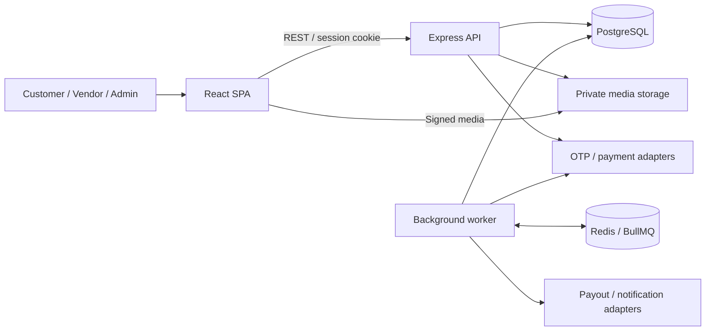

# PawPals — Pet Care Marketplace

PawPals is a full-stack marketplace prototype that connects pet owners with pet care providers. It supports appointment booking, vendor operations, payment workflows, private communication, and role-based administration.

**Status:** portfolio prototype (Premium UI/UX baseline). UX refinement, bug fixes and end-to-end verification are ongoing. Demo payments do not move real money.

## Key features

| Customer | Vendor | Admin |
|---|---|---|
| Service discovery and pet profiles | Onboarding and verification | Vendor review and moderation |
| Slot selection and booking | Service, package and capacity management | Booking and payment monitoring |
| Demo checkout and order tracking | Service execution and milestones | Refund, settlement and payout oversight |
| Private messaging, reviews and support | Messaging and finance summaries | Case management, permissions and audit |

## Technology stack

- Frontend: React 19, Vite 8, TypeScript, Tailwind CSS 4, React Router and Lucide.
- Backend: Node.js, Express 5, TypeScript and REST API (`/api/v1`).
- Database: PostgreSQL with PostGIS, pgcrypto and btree_gist.
- Background processing: Redis, BullMQ and a transactional outbox.
- Integrations: S3-compatible private media, local media emulator, Twilio Verify, Midtrans, and a provider-neutral payout adapter.

## Engineering highlights

- Capacity reservations, occupied intervals including buffers, database guards and serializable booking transactions.
- Idempotent payment processing, refund adjustments, ledger entries and settlement/payout state transitions.
- Durable outbox acknowledgement, retries, dead-letter replay and provider reconciliation.
- Server-managed HttpOnly sessions, role-based administration, ownership checks and signed private-media access.

## Architecture



See [System Architecture](docs/ARCHITECTURE.md) for component responsibilities. PostgreSQL is the authority for transactional state; the frontend does not guarantee slot availability before booking succeeds.

## Repository structure

```text
BackEnd/           API, domain logic, database migrations, OpenAPI and tests
FrontEnd/          React application and public assets
scripts/           Local development and operational helpers
docs/              Six core product and engineering documentation areas
.env.example       Example environment configuration
.gitignore         Local and sensitive file exclusions
```

## Getting started (local development, Windows / PowerShell)

Requirements: Node.js 22.13+ within the 22.x series or Node.js 24, npm, PostgreSQL with the required extensions, Redis and Git. PostgreSQL, Redis and the local media emulator must be configured separately. Use a local development database, never a production database.

1. For a fresh install, follow the [database migration guide](BackEnd/database/README.md). Use the combined 001–026 migration only on an empty database, then apply the actual 027 patch. Keep existing populated databases intact; do not reapply the full baseline.
2. From the repository root, copy the example **only if no local environment file exists**:

   ```powershell
   if (!(Test-Path BackEnd/.env)) { Copy-Item .env.example BackEnd/.env }
   ```

   Configure `DATABASE_URL`, unique `APP_TOKEN_SECRET` and `DATA_ENCRYPTION_KEY` (at least 24 characters each), `REDIS_URL=redis://127.0.0.1:6379`, and `APP_ALLOWED_ORIGINS=http://localhost:5173,http://127.0.0.1:5173`. For the local media emulator, set `MEDIA_S3_ENDPOINT=http://127.0.0.1:9100`, `MEDIA_S3_BUCKET`, `MEDIA_S3_REGION`, `MEDIA_S3_ACCESS_KEY_ID` and `MEDIA_S3_SECRET_ACCESS_KEY` with appropriate local values. Keep these private. Set `NODE_ENV=development` and `PAWPALS_ENABLE_MOCK_PAYMENTS=true` only for local demo payments. Local OTP is for development only.
3. Install and build both apps in separate terminals starting at the repository root:

   ```powershell
   cd BackEnd
   npm ci
   npm run build
   ```

   ```powershell
   cd FrontEnd
   npm ci
   npm run lint
   npm run build
   ```
4. Start PostgreSQL and Redis. If using Ubuntu WSL for Redis, run `sudo service redis-server start` and `redis-cli ping` (expect `PONG`). From the repository root:

   ```powershell
   powershell -ExecutionPolicy Bypass -File .\scripts\start-pawpals-dev.ps1
   ```

   The script starts the API (3000), local media (9100), Vite (5173), and worker if Redis is reachable. Avoid duplicate processes. Open http://localhost:5173. Customer registration is available through the UI; vendor activation requires review. Admin provisioning requires an authorized local setup; role seeds do not create an admin login.

See [Frontend guide](FrontEnd/README.md) for frontend commands. The local script and Vite proxy are not a production deployment setup.

## Documentation

| Document | Description |
|---|---|
| [PRD](docs/prd/README.md) | Product scope, requirements and Word document |
| [System Flow](docs/system-flow/README.md) | End-to-end domain flows |
| [API Contract](docs/api-contract/README.md) | AC-01–AC-12 operation index |
| [ERD](docs/erd/README.md) | Database diagrams and data dictionary |
| [Business Rules](docs/business-rules/README.md) | Domain rules, state transitions and role grants |
| [System Architecture](docs/ARCHITECTURE.md) | Technical design |

Machine-readable contract: [OpenAPI 1.2.0](BackEnd/openapi/openapi.yaml). It documents 151 operations; one additional route supports explicitly enabled non-production mock payment simulation.

## Validation

From `BackEnd/`, run `npm test` (route coverage, TypeScript check, build and Node regression tests). Database integration tests require dedicated local test databases and explicit opt-in; never use the main development database. See the [database guide](BackEnd/database/README.md).

From `FrontEnd/`, run `npm run lint` and `npm run build`.

Previous Premium baseline: 49 automated backend tests passed; 3 PostgreSQL integration tests were skipped in that validation environment. Route coverage was 151 documented operations plus one development-only route. Browser previews used isolated fixture data. These are historical results, not evidence that the latest local checkout has passed. Vite production build and complete end-to-end verification remain to be confirmed on the target environment.

## Current limitations

- UX refinement and bug fixing are ongoing; full multi-role end-to-end testing is incomplete.
- Persistent notification center, complete public service photo gallery, aggregated analytics and self-service password recovery UI are not fully implemented.
- Real OTP, payment, refund, payout and production storage integrations require separate sandbox/configuration validation. The payout adapter is provider-neutral, not a certified integration.
- Development-only mock payments, local OTP and local media must not be exposed in production. This project is not production-certified.

Never commit real `.env` files, database dumps, private media, credentials or personal information. Use the example configuration and synthetic demo data for public presentation.
