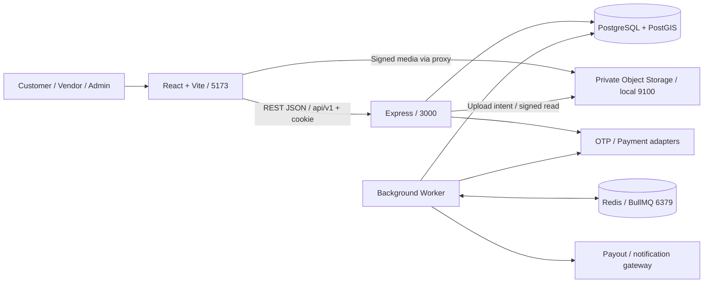

# System architecture
PawPals adalah aplikasi client-server dengan SPA dan modular monolith. Bukan microservices.

| Lapisan | Teknologi dari package.json / source | Tanggung jawab |
|---|---|---|
| Frontend | React 19, Vite 8, TypeScript 6, Tailwind CSS 4, React Router 7, Lucide | UI, routing, form, polling, API client |
| Backend | Express 5, TypeScript 5.9, Node.js, pg | Validasi, sesi, domain transactions, REST |
| Persistence | PostgreSQL, PostGIS, pgcrypto, btree_gist | Constraints, FK, status, concurrency, geography |
| Worker | BullMQ, ioredis, Node.js | Expiry, refund, settlement/payout, reconciliation, outbox |
| Private media | S3-compatible adapter; local emulator (demo) | Blob privat, signature, metadata di DB |
| Provider | Twilio Verify, Midtrans, MOCK dev, provider-neutral disbursement | Batas integrasi; provider nyata belum divalidasi penuh |

## Struktur dan alur request
- `FrontEnd/src/App.tsx`: public/protected routes, session context; `WorkspaceLayout` membedakan ruang kerja.
- `FrontEnd/src/lib/api.ts`: fetch `/api/v1`, cookie `credentials: include`, error envelope.
- `FrontEnd/vite.config.ts`: `/api` proxy ke 3000; `/local-media` ke 9100. Port lokal bukan deployment production.
- `BackEnd/src/app.ts`: JSON limit 1 MB, request ID, session loading, CSRF origin guard, route modul, not-found/error handler.
- `BackEnd/src/shared/db/database.ts`: query/transaksi PostgreSQL. `shared/repositories/access.ts` menjaga ownership. `shared/domain/finance.ts` menangani posting ekonomi.
- `BackEnd/src/jobs/worker.ts`: tick setiap 60 detik; provider reconciliation sebelum expiry, kemudian domain jobs, dispatch payout dan delivery outbox jika Redis siap. Consumer BullMQ concurrency 4.
- `BackEnd/src/jobs/outbox-events.ts`: transactional outbox, consumer acknowledgement durable, retry/dead-letter. Bukan jaminan exactly-once pada jaringan; consumer perlu dedup event key.

## Boundaries
PostgreSQL adalah otoritas state; slot yang terlihat di UI hanya advisory. Harga dan status tidak dipercaya dari browser. Session HttpOnly, RBAC dan private media diverifikasi backend. Data sensitif bukan data publik. Konfigurasi production harus disediakan eksplisit; adapter lokal tidak boleh terekspos publik.

Source: `BackEnd/package.json`, `FrontEnd/package.json`, `BackEnd/src/app.ts`, `BackEnd/src/jobs/worker.ts`, `FrontEnd/src/lib/api.ts`, `FrontEnd/vite.config.ts`, OpenAPI 1.2.0.
