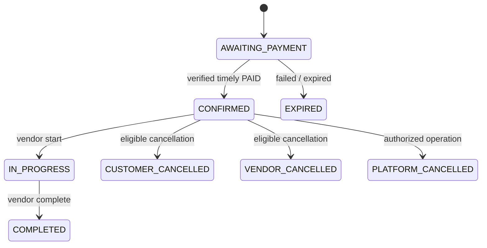

# Business rules — baseline implementasi
Aturan inti dari PRD v3.0, migration dan router. Nilai default dapat diubah oleh environment yang sah; snapshot booking menjadi referensi historis. Jangan menafsirkan seluruh kebijakan sebagai bukti pengujian runtime.

| ID | Rule | Source / enforcement |
|---|---|---|
| BR-01 | Account aktif untuk protected action; phone E.164, password hash Scrypt, session dan grants | auth router, middleware/auth, security |
| BR-02 | OTP dibatasi purpose, expiry, attempt dan resend; development adapter saja bila provider tidak ada; production perlu purpose-bound provider | auth router, providers/verification, env |
| BR-03 | Vendor perlu application dan review; status ACTIVE sebelum layanan dapat dipesan | vendors/services/bookings |
| BR-04 | Lokasi layanan, paket aktif, harga IDR >0; bukan free booking | migrations 024, services, bookings |
| BR-05 | 1 booking = 1 pet dan 1 unit kapasitas; species/size dan reactivity/aggression sesuai rule layanan | bookings, constraint trigger |
| BR-06 | AT_CUSTOMER memeriksa lokasi dan service radius; AT_VENDOR dari origin location mitra | bookings, PostGIS |
| BR-07 | Minimum notice; full occupied interval = durasi + buffer; availability dan effective capacity diperiksa saat commit | booking-options, database guard |
| BR-08 | Hold pending payment hanya hingga expiry; COMMITTED memblokir kapasitas. Slot advisory tidak menjamin reservasi | capacity_reservations, worker |
| BR-09 | Harga, lokasi, paket, pet/safety dan kebijakan dicatat sebagai snapshot; customer/vendor ownership diperiksa | bookings, 017 constraints |
| BR-10 | PAID tepat waktu → CONFIRMED + COMMITTED; duplicate event tidak menggandakan ledger; provider dan amount harus cocok | payment-events, finance |
| BR-11 | Late PAID provider nyata tidak menghidupkan kembali booking; wajib refund dan case exception. MOCK late PAID ditolak | payment-events |
| BR-12 | Customer self-cancel hanya CONFIRMED; preview refund >24 jam 100%, 6–24 jam 50%, <6 jam 0%. Tidak self-cancel IN_PROGRESS | cancellations router |
| BR-13 | Self-reschedule batas 1 applied, notice default 24 jam; vendor proposal memerlukan keputusan customer; swap capacity atomic | cancellation router, policy snapshot |
| BR-14 | Refund harus <= sisa nilai paid; ledger adjustment idempotent; post-payout refund menimbulkan debit | finance, refund constraints |
| BR-15 | Completion memulai HOLD; settlement release jika eligible dan tidak terhalang dispute; payout net minimum + verified account | domain-jobs |
| BR-16 | Payout ambiguous tetap PROCESSING untuk reconciliation, FAILED mengembalikan allocation, PAID menyelesaikan settlement | payout-jobs |
| BR-17 | Chat dan media hanya booking participant/authorized user; data vendor sebelum confirmed disaring | interactions, bookings, media |
| BR-18 | Review sesuai eligibility layanan selesai; support case booking-bound; akses evidence restricted | interactions, trust-safety |
| BR-19 | Admin action mengikuti permission server dan audit; UUID bukan akses | admin, middleware/auth, 022 seed |
| BR-20 | Outbox event unique/durable, retry dan replay tidak boleh menduplikasi consumer acknowledgement | 026, outbox-events, replay script |

## Default kebijakan
| Variable | Default source |
|---|---|
| SESSION_TTL_HOURS | 168 jam |
| OTP_TTL_MINUTES / OTP_MAX_ATTEMPTS / OTP_RESEND_COOLDOWN_SECONDS | 10 menit / 5 / 60 detik |
| RESET_GRANT_TTL_MINUTES / REAUTH_GRANT_TTL_MINUTES / SENSITIVE_GRANT_TTL_MINUTES | 10 menit masing-masing |
| PAYMENT_HOLD_MINUTES | 15 menit |
| SETTLEMENT_HOLD_MINUTES | 1440 menit |
| CANCELLATION_CLAIM_WINDOW_MINUTES | 1440 menit |
| CUSTOMER_SELF_RESCHEDULE_MIN_NOTICE_MINUTES | 1440 menit |
| COMMISSION_RATE_BPS | 500 (5%) |
| MINIMUM_PAYOUT_AMOUNT | Rp50.000 |

Nilai di atas bukan jaminan konfigurasi database lokal pengguna.

## Role dan permission seed
| Role | Bundle 022_seed_rbac.sql |
|---|---|
| SUPER_ADMIN | Seluruh permission seed |
| OPERATIONS_ADMIN | operations.vendor_application.review; operations.vendor.suspend; operations.booking.view; audit.view |
| FINANCE_ADMIN | finance.payment.view; finance.refund.manage; finance.ledger.view; finance.payout.manage; audit.view |
| TRUST_SAFETY_ADMIN | trust_safety.case.manage; trust_safety.sensitive_access; audit.view |

Customer/Vendor memakai ownership dan status domain; tidak otomatis menjadi admin. Permission aktual tergantung assignments dalam database. UI menu bukan security boundary.

Source: `BackEnd/src/config/env.ts`, `BackEnd/src/modules/*/router.ts`, `BackEnd/src/shared/domain/*`, `BackEnd/src/jobs/*`, migration 002/017/021–026. Scope rinci dan kebutuhan UX: [PRD](../prd/README.md).

## State machines
Status resmi berupa enum PostgreSQL. Diagram/daftar di bawah menunjukkan lifecycle utama, bukan semua edge atau izin transisi; guard SQL, router dan worker adalah otoritas. Jangan memutakhirkan status manual untuk melewati business rule.

| Domain | Lifecycle utama | Guard / efek |
|---|---|---|
| Account | PENDING_PHONE_VERIFICATION → ACTIVE; DISABLED | Verifikasi OTP; requireActive |
| Session | ACTIVE → EXPIRED / REVOKED | TTL, logout, reset |
| OTP | PENDING → VERIFIED / EXPIRED / LOCKED / CANCELLED | Purpose, attempts, expiry; konsumsi challenge dibedakan dari status |
| Vendor application | DRAFT → SUBMITTED → UNDER_REVIEW → APPROVED / REJECTED / NEEDS_REVISION; revisi dapat diajukan kembali | Admin review, dokumen, terms |
| Vendor | PENDING_APPROVAL → ACTIVE ↔ SUSPENDED | Approval dan permission moderasi |
| Verification document | SUBMITTED → VERIFIED / NEEDS_REPLACEMENT / REJECTED | Revisi dan review |
| Service | DRAFT → ACTIVE ↔ INACTIVE | Lokasi, pet rule dan paket |
| Booking | CREATED (enum) / AWAITING_PAYMENT → CONFIRMED → IN_PROGRESS → COMPLETED; EXPIRED / CUSTOMER_CANCELLED / VENDOR_CANCELLED / PLATFORM_CANCELLED | Create route langsung AWAITING_PAYMENT; cancellation dan expiry bersyarat |
| Capacity | HELD → COMMITTED / RELEASED / EXPIRED; COMMITTED → RELEASED sesuai operasi | Expiry, occupied interval dan swap |
| Payment | PENDING → PAID / FAILED / EXPIRED; late verified PAID memiliki exception flow | Tidak resurrect booking; refund obligation untuk late provider paid |
| Refund | REQUESTED → PROCESSING → SUCCEEDED / FAILED | Retry terkontrol, cumulative cap, reconciliation |
| Reschedule | PENDING → APPLIED / DECLINED / FAILED / CANCELLED | Capacity swap; proposal approval |
| Vendor cancellation claim | OPEN → VENDOR_ADMITTED / VENDOR_DENIED / UNDER_REVIEW → RESOLVED (sesuai tindakan) | Atribusi dan keputusan |
| Settlement | PENDING → HOLD → AVAILABLE → ALLOCATED → SETTLED; REVERSED; ALLOCATED → AVAILABLE saat payout failed | Eligibility, dispute, negative adjustment |
| Payout | QUEUED → PROCESSING → PAID / FAILED | Provider reconcile jika ambiguous |
| Case | OPEN → TRIAGED → INVESTIGATING → RESOLVED → CLOSED (sesuai aksi) | Permission dan bukti |
| Outbox | PENDING → PUBLISHED / DEAD_LETTER; replay DEAD_LETTER → PENDING jika belum diakui | Durable consumer ack |

### Cross-domain matrix
| Event | Booking | Capacity | Payment / finance |
|---|---|---|---|
| Create | AWAITING_PAYMENT | HELD | PENDING |
| Paid timely | CONFIRMED | COMMITTED | PAID, ledger dan earning tercatat sekali |
| Failed / expired | EXPIRED | RELEASED / EXPIRED | FAILED / EXPIRED |
| Late verified Midtrans paid | Tidak CONFIRMED kembali | Tidak reclaim slot | PAID, full refund obligation, case exception |
| Complete | COMPLETED | Riwayat reservation dipertahankan | Earning PENDING → HOLD |
| Refund succeeded | Bergantung cancellation / case | Tidak menebak perubahan | Posting refund/adjustment; payment tetap terpisah |
| Payout paid | Tidak berubah | Tidak berubah | Settlement ALLOCATED → SETTLED |
| Payout failed | Tidak berubah | Tidak berubah | Settlement ALLOCATED → AVAILABLE |

Source: `002_enums.sql`, `021_functions_triggers.sql`, `024_final_api_cross_review_fixes.sql`, `025_capacity_settlement_guard_fixes.sql`; booking/payment/cancellation/vendor/trust-safety routers dan worker. Beberapa nilai enum tersedia untuk domain completeness; daftar ini tidak menyatakan seluruh edge tersedia melalui UI.
