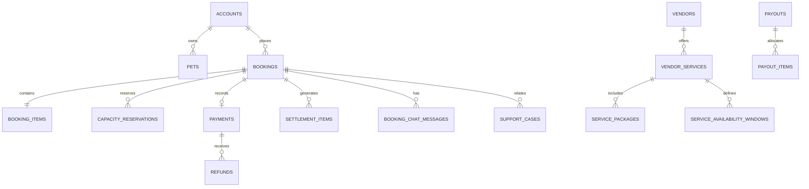

# Entity relationship diagram — Premium UI/UX
ERD dikelompokkan berdasarkan tujuh domain. **58 tabel dan 109 deklarasi foreign key** pada inventaris sebelumnya; Pada baseline Premium, 27 file migration identik dengan ZIP sumber ERD 12 November. File 027 kemudian dipulihkan dari paket hotfix asli; perubahannya hanya pada fungsi guard, bukan relasi atau struktur tabel. Tidak ada perubahan schema tabel pada redesign Premium. Diagram dan data dictionary dipakai ulang dengan provenance terbaru, bukan direkayasa ulang. FK menunjukkan relasi deklaratif, bukan seluruh cardinality bisnis, check, partial index atau trigger. Diagram tidak menggantikan SQL. Database runtime belum diinspeksi.

[Data dictionary lengkap](data-dictionary.md) — tabel, kolom, type, key, nullability dan FK. Source diagram Graphviz `.dot` ada dalam `diagrams/dot/`.

| Domain | Diagram |
|---|---|
| Identitas & akses | [SVG](diagrams/svg/ERD_01_01_identitas_dan_akses.svg) |
| Vendor & verifikasi | [SVG](diagrams/svg/ERD_02_02_vendor_dan_verifikasi.svg) |
| Customer, hewan & layanan | [SVG](diagrams/svg/ERD_03_03_customer_hewan_layanan.svg) |
| Booking, cancellation & reschedule | [SVG](diagrams/svg/ERD_04_04_booking_cancel_reschedule.svg) |
| Payment, refund & finance | [SVG](diagrams/svg/ERD_05_05_payment_refund_finance.svg) |
| Interaksi, trust & audit | [SVG](diagrams/svg/ERD_06_06_interaksi_trust_dan_audit.svg) |
| Outbox & consumer | [SVG](diagrams/svg/ERD_07_07_outbox_dan_consumer.svg) |

## Relasi inti (simplifikasi)

Cardinalities di sini sengaja disederhanakan; constraint unik, one-pet booking, composite FK dan revisi reservation mengikuti diagram SQL/DDL. Outbox acknowledgement terpisah dari event. Gunakan migration yang benar saat bootstrap; file 027 telah dipulihkan sebagai patch, lihat [panduan database](../../BackEnd/database/README.md).
