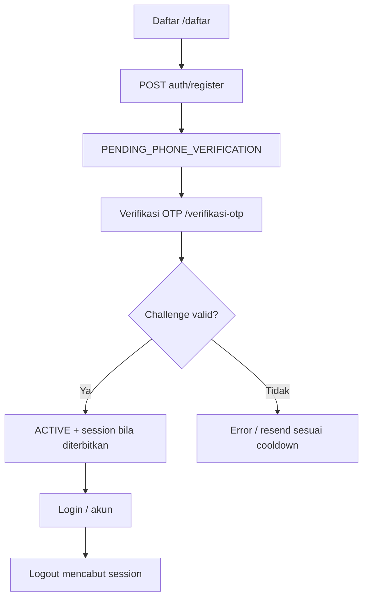
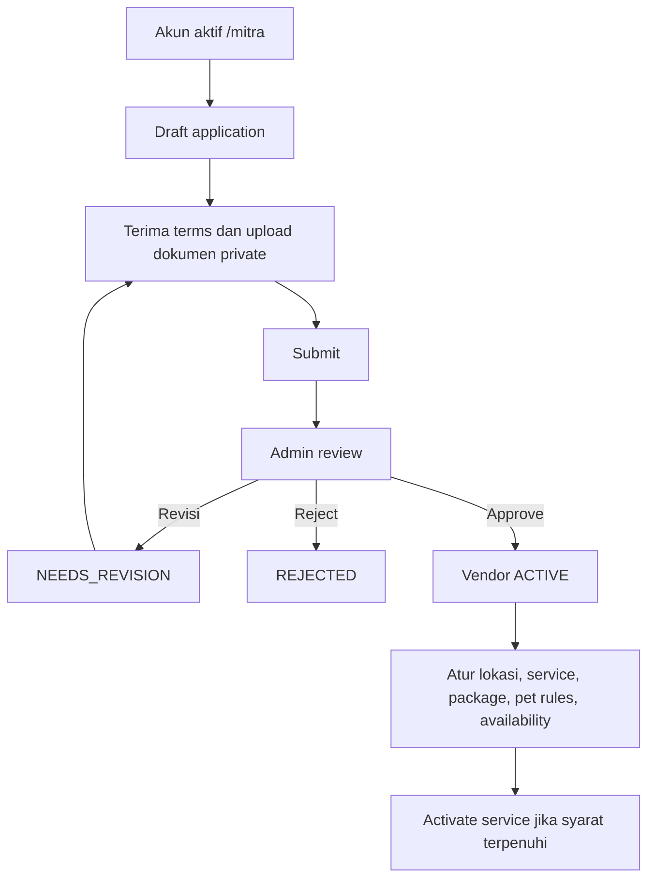
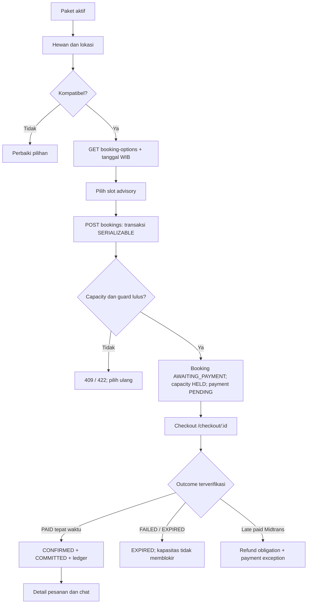
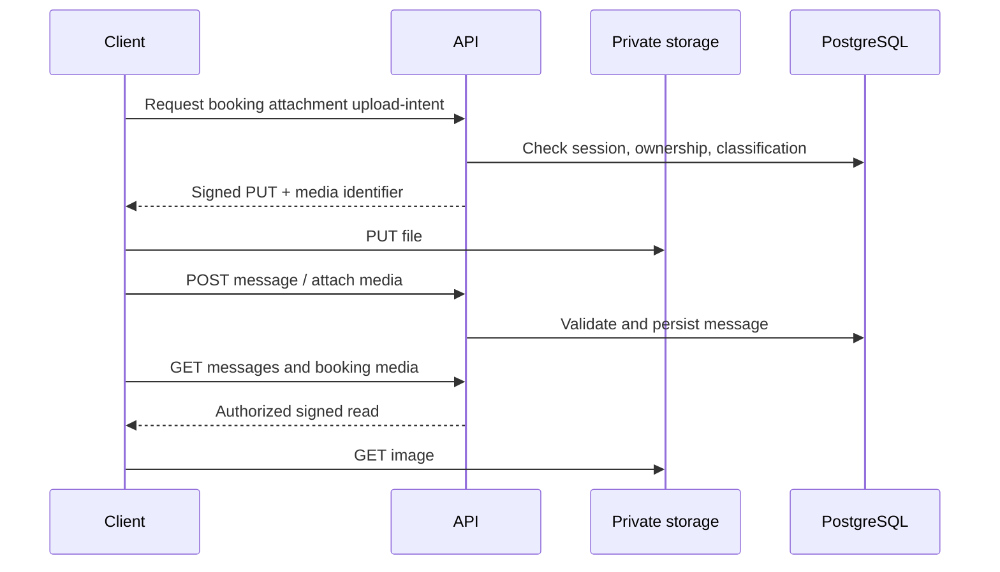
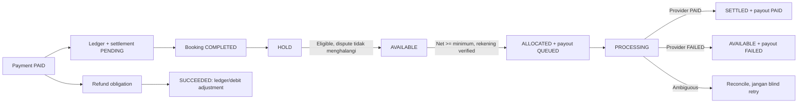

# System flow — Premium UI/UX
Diagram berikut menggambarkan alur implementasi dan guard yang berlaku. Ini bukan bukti keberhasilan E2E. Path halaman tercatat pada `FrontEnd/src/App.tsx` dan operation detail di OpenAPI.

## SF-01 — Account dan OTP

Password recovery, re-auth dan sensitive OTP tersedia di backend; recovery UI mandiri belum lengkap.

## SF-02 — Vendor application dan activation

## SF-03 — Customer profile dan discovery
Beranda `/` → katalog `/layanan` → detail `/layanan/:id` → paket. Jika belum login, login dan kembali ke tujuan. Kelola hewan/safety di `/hewan`, alamat di `/alamat`. AT_CUSTOMER memerlukan alamat dan eligibility lokasi; AT_VENDOR memakai lokasi mitra.

## SF-04 — Instant Booking dan checkout

Hold default 15 menit. Buffer ikut occupied interval; slot bukan garansi. MOCK menolak late paid dan hanya development.

## SF-05 — Pelaksanaan layanan, milestone dan review
Vendor `/mitra/pesanan` → detail booking terkonfirmasi → start → IN_PROGRESS → milestone teks/foto → complete → COMPLETED. Customer melihat perkembangan pada detail pesanan, review sesuai eligibility. Settlement service earning PENDING menjadi HOLD setelah completion. Start pada source memeriksa status CONFIRMED; jangan mengklaim guard waktu start sudah diverifikasi.

## SF-06 — Chat dan private media

Inbox `/pesan` dan `/mitra/pesan`, thread berdasarkan booking. Read-state dan polling; bukan socket chat atau social messaging. Dokumen verifikasi, pet photo, evidence dan milestone memakai alur media sesuai domain.

## SF-07 — Cancellation dan reschedule
Customer melihat cancellation-preview, kemudian submit cancel bila eligible; kebijakan snapshot, refund obligation dan release capacity diproses server. Vendor cancellation dapat memerlukan atribusi/claim. Reschedule customer self atau vendor proposal; penerimaan melakukan validasi ulang dan atomic capacity swap, kegagalan tidak boleh merusak jadwal lama. Opsi/proposal dibaca dari API, bukan input jadwal sembarang.

## SF-08 — Refund, settlement, payout

Refund lifecycle terpisah dari payment status. Refund sebelum dan setelah payout harus ditangani konsisten oleh ledger. Gateway payout nyata belum divalidasi.

## SF-09 — Trust & Safety dan Admin
Customer/Vendor membuka case terkait booking → lampiran evidence → Admin sesuai permission assign/triage/investigate/resolve/close. Evidence restricted memerlukan akses terotorisasi. Admin `/admin/*`: review vendor, monitoring booking/payment, refund, ledger, settlement, payout, case, RBAC, audit sesuai permission. Bukan semua admin memiliki akses semua modul.

## SF-10 — Outbox dan reconciliation
Domain write + outbox satu transaksi → worker publish ke BullMQ dan tandai PUBLISHED → consumer memeriksa acknowledgement, kirim HMAC webhook, catat outbox_consumptions setelah HTTP 2xx. PUBLISHED bukan bukti delivery. Event PUBLISHED tanpa ack setelah 5 menit dapat dipublish ulang; 8 publish cycles tanpa ack masuk DEAD_LETTER. BullMQ job memakai 5 attempts dengan exponential backoff. Receiver wajib dedup berdasarkan event_key. Operator replay hanya event belum diakui, melalui `BackEnd/scripts/replay-outbox.cjs`. Worker juga reconcile pending payment, processing refund/payout; tidak blind-resubmit hasil ambiguous.

Source: router domain auth/vendors/services/bookings/payments/cancellations/finance/interactions/trust-safety/admin; `shared/domain/payment-events.ts`, `jobs/worker.ts`, `jobs/outbox-events.ts`. Lihat [state machine dalam Business Rules](../business-rules/README.md#state-machines) untuk status terpisah.
